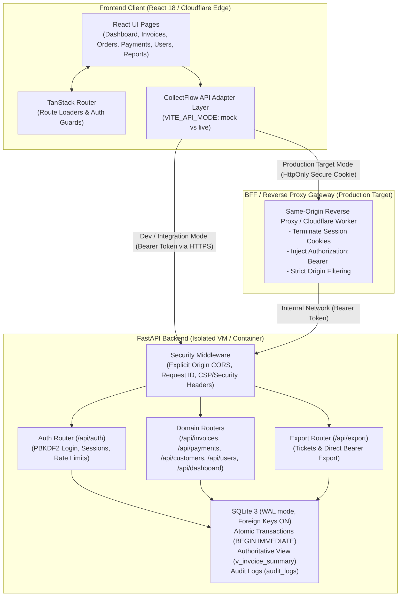
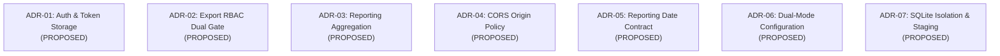
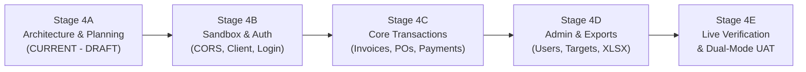

# CollectFlow Phase 4 Stage 4A: Backend Integration Architecture, Contract Discovery & Gap Assessment

**Document Status:** **DRAFT — Pending Architecture Review and Approval**  
**Document Reference:** `COLLECTFLOW_PHASE4_STAGE4A_ARCHITECTURE_AND_GAP_ASSESSMENT.md`  
**Engagement Phase:** Phase 4 — Stage 4A (Backend Integration Architecture & Planning)  
**Target Repository:** `/home/anishb/projects/personal/cash-flow-buddy-101`  
**Target File Path:** `docs/plans/COLLECTFLOW_PHASE4_STAGE4A_ARCHITECTURE_AND_GAP_ASSESSMENT.md`  
**Planning Branch:** `docs/phase4-stage4a-architecture-plan` (branched from approved release commit `b4c4b25f634e2f0131b7299570f994f3e6a3502f`)  
**Frontend Implementation Baseline:** `ae31b54891b127994731400b91ce8d2e6f3aa580` (Preserved intact)  
**Backend Checkpoint:** `/home/anishb/projects/personal/collectflow` (FastAPI / SQLite reference backend, read-only)  
**Independent Frontend Verdict:** PASS WITH LIMITATIONS (Cloudflare staging version `baab2a80-db25-47f9-ac78-8d15b7ae2aec`)  

---

## 1. Executive Summary

CollectFlow Phase 3 completed the design, implementation, and verification of a modern SaaS financial management frontend across Stages 0 through 6, concluding with the independent verdict **PASS WITH LIMITATIONS**. The client application is hosted on Cloudflare Workers staging using an in-memory, deterministic mock dataset anchored to the approved two-record financial baseline:
- `INV-2026-042` (Active partially settled commercial invoice: ₹5,31,000 gross, ₹2,09,000 settled, ₹3,22,000 outstanding)
- `PO-NEXUS-881` (Unbilled purchase order: ₹2,50,000 exclusive, ₹2,95,000 gross, ₹0 settled, ₹0 recognized AR)

The backend is an authoritative FastAPI application backed by a WAL-mode SQLite database featuring strict foreign key enforcement, atomic write locks (`BEGIN IMMEDIATE`), financial 2-decimal rounding, and audit logging.

**Stage 4A Architectural Corrections & Discoveries:**
1. **Domain Alignment:** The frontend financial model, field naming, and lifecycle states (Orders vs. Invoices, cash/TDS settlements, cancellation immutability, and 17-column export layout) match the backend's `v_invoice_summary` view and SQLite schema.
2. **Authentication Security Reassessment:** In-browser `sessionStorage` Bearer tokens are suitable for isolated integration testing but carry XSS risks. For production, an `HttpOnly`, `Secure`, `SameSite=Lax` cookie architecture backed by a same-origin Backend-For-Frontend (BFF) / reverse proxy is recommended.
3. **Export Authorization Dual Gate:** The backend export endpoint (`GET /api/export/excel`) accepts both direct `Authorization: Bearer <token>` headers and single-use tickets (`?ticket=<token>`). To enforce the proposed Admin/Finance restriction without API bypass, authorization must be validated at both `POST /api/export/token` and inside `authenticate_export_request` for direct Bearer requests.
4. **Reporting Aggregations & Dataset Scale:** Relying on `GET /api/invoices?limit=1000` is incomplete and unsafe for datasets exceeding 1,000 records. A hybrid approach is specified: dedicated server-side aggregation endpoints for production, with client-side reconciliation and completeness validation for bounded datasets.
5. **Reporting Date Divergence:** The frontend mock reporting date is pinned to **30 April 2026** (yielding 0 days overdue for `INV-2026-042` due 12 May 2026). The backend's SQL view uses dynamic `DATE('now')` and `JULIANDAY('now')`. An explicit as-of date parameter contract is proposed.
6. **Payment Idempotency:** The backend verifies idempotency replay under transaction lock, accepting the key from **both** `item.idempotency_key` (request body) and `request.headers.get("idempotency-key")`.
7. **Environment Isolation Guardrails:** The public Cloudflare mock staging environment must remain 100% untouched and offline. A separate, authenticated integration environment with synthetic seed data must precede any live integration.

*Strict Scope Notice: This document is DISCOVERY AND PLANNING ONLY. No application code, backend APIs, or databases have been modified. All architectural decisions remain PROPOSED pending explicit stakeholder approval.*

---

## 2. As-Is Architecture Assessment

### 2.1 Frontend Architecture (`cash-flow-buddy-101`)
- **Runtime & Deployment:** Nitro server engine targeting `cloudflare-module` deployed on Cloudflare Workers edge nodes.
- **Client Stack:** React 18, TypeScript (strict mode), TanStack Router (file-based routing), Tailwind CSS, Lucide icons.
- **Accurate Route Tree & Navigation:**
  - Route modules in `src/routes/`:
    - `/` (`src/routes/index.tsx`): Main entry and dashboard view.
    - `/orders` (`src/routes/orders.tsx`): Purchase orders workspace.
    - `/invoices` (`src/routes/invoices.tsx`): Commercial invoices workspace.
    - `/payments` (`src/routes/payments.tsx`): Cash and TDS settlements ledger.
    - `/customers` (`src/routes/customers.tsx`): Customer directory and exposure.
    - `/sales-targets` (`src/routes/sales-targets.tsx`): Sales targets management.
    - `/performance-analytics` (`src/routes/performance-analytics.tsx`): Target achievement analytics.
    - `/users` (`src/routes/users.tsx`): User directory and administration.
    - `/reports` (`src/routes/reports.tsx`): Multi-tab financial reports hub.
    - `/ar-aging` (`src/routes/ar-aging.tsx`): Accounts receivable aging analysis.
    - `/settings` (`src/routes/settings.tsx`): Reference data (FYs, GST, TDS).
    - `/design-comparison` (`src/routes/design-comparison.tsx`): Visual regression tool.
- **Accurate Mock & Data Layer Structure:**
  - Files located in `src/data/` (not `src/mock/`):
    - `src/data/records.ts`: Baseline invoice and purchase order state.
    - `src/data/payments.ts`: Settlement transactions and ledger logic.
    - `src/data/targets.ts`: Target fixtures and attainment calculations.
    - `src/data/users.ts`: User directory state and permissions.
    - `src/data/references.ts`: Financial years and tax rates.
    - `src/data/reporting.ts`: Reporting metrics and aggregation calculations.
    - `src/data/demo-policy.ts`: Demo boundaries and guardrails.
    - `src/data/api-contracts.ts` & `src/data/demo-contracts.ts`: Frontend contract definitions.
- **Guards & Roles:** Client-side evaluation via `MockSessionContext` (`src/components/collectflow/session.tsx`). Permissions are asserted in-memory; role changes update affordances and block mid-workflow drawer confirmations.

### 2.2 Backend Architecture (`collectflow`)
- **Framework & Runtime:** FastAPI 0.115+ running under Python 3.12 with Uvicorn.
- **Persistence & Concurrency:** SQLite 3 with `PRAGMA foreign_keys = ON; PRAGMA journal_mode = WAL; PRAGMA busy_timeout = 5000;`. Write operations execute inside a transaction context manager running `BEGIN IMMEDIATE;` to serialize writes while permitting concurrent WAL readers.
- **Authoritative Database View (`v_invoice_summary`):**
  Defined in `app/database.py` (lines 233–284). Aggregates `invoices` with `customers`, `users`, and `payments`:
  ```sql
  CREATE VIEW v_invoice_summary AS
  SELECT
      i.id, i.customer_id, i.executive_id, i.fy_code, i.order_type,
      i.po_date, i.po_number,
      COALESCE(i.customer_name, c.billing_name, 'Unknown Customer') AS customer_name,
      COALESCE(i.customer_gstin, c.gst_number) AS customer_gstin,
      COALESCE(i.customer_address, c.billing_address) AS customer_address,
      COALESCE(i.customer_state, c.state) AS customer_state,
      COALESCE(u.full_name, u.username) AS executive_name,
      i.currency, i.exchange_rate, i.original_amount, i.exclusive_amount,
      i.tax_amount, i.total_amount, i.invoice_number, i.invoice_date, i.due_date,
      ROUND(COALESCE(SUM(p.payment_amount), 0), 2) AS total_cash_paid,
      ROUND(COALESCE(SUM(p.tds_amount), 0), 2) AS total_tds_deducted,
      ROUND((COALESCE(SUM(p.payment_amount), 0) + COALESCE(SUM(p.tds_amount), 0)), 2) AS total_paid,
      CASE
          WHEN i.payment_status = 'CANCELLED' THEN 0.0
          ELSE ROUND((i.total_amount - (COALESCE(SUM(p.payment_amount), 0) + COALESCE(SUM(p.tds_amount), 0))), 2)
      END AS outstanding_balance,
      CASE
          WHEN i.payment_status = 'CANCELLED' THEN 'CANCELLED'
          WHEN (i.invoice_number IS NULL OR trim(i.invoice_number) = '') AND (i.invoice_date IS NULL OR trim(i.invoice_date) = '') THEN 'UNBILLED'
          WHEN ROUND((i.total_amount - (COALESCE(SUM(p.payment_amount), 0) + COALESCE(SUM(p.tds_amount), 0))), 2) <= 0 THEN 'PAID'
          WHEN (COALESCE(SUM(p.payment_amount), 0) + COALESCE(SUM(p.tds_amount), 0)) > 0 THEN 'PARTIAL'
          WHEN i.due_date IS NOT NULL AND DATE('now') > i.due_date THEN 'OVERDUE'
          ELSE 'PENDING'
      END AS computed_status,
      CASE
          WHEN i.payment_status = 'CANCELLED' THEN 0
          WHEN (i.invoice_number IS NULL OR trim(i.invoice_number) = '') AND (i.invoice_date IS NULL OR trim(i.invoice_date) = '') THEN 0
          WHEN ROUND((i.total_amount - (COALESCE(SUM(p.payment_amount), 0) + COALESCE(SUM(p.tds_amount), 0))), 2) <= 0 THEN 0
          WHEN i.due_date IS NULL THEN 0
          WHEN DATE('now') > i.due_date THEN CAST(JULIANDAY('now') - JULIANDAY(i.due_date) AS INTEGER)
          ELSE 0
      END AS days_overdue
  FROM invoices i
  LEFT JOIN customers c ON i.customer_id = c.id
  LEFT JOIN users u ON i.executive_id = u.id
  LEFT JOIN payments p ON i.id = p.invoice_id
  GROUP BY i.id;
  ```
- **Security & RBAC:**
  - Password hashing: PBKDF2-HMAC-SHA256 (120,000 iterations, 16-byte cryptographically secure random salt).
  - Sessions: 32-byte URL-safe tokens returned upon login; stored in SQLite as SHA-256 hashes with 7-day expiration.
  - Role Hierarchy: `admin` (super-admin), `finance` (financial controller), `sales` (account executive), `viewer` (read-only auditor).
  - Enforced via FastAPI dependencies: `get_current_user`, `require_admin`, `require_finance_or_admin`, `require_roles(...)`.
- **Audit & Export:**
  - `audit_logs` table recording action, target entity, record ID, user ID, client IP, request ID, and timestamp.
  - `openpyxl` streaming export using single-use 5-minute tickets (`POST /api/export/token` → `GET /api/export/excel?ticket=...`).

---

## 3. Proposed Target Integration Architecture



### Architectural Modes:
1. **Integration Mode (`VITE_API_MODE = 'live'`):** Frontend connects directly to an isolated integration FastAPI backend over HTTPS using Bearer tokens stored in `sessionStorage`. Enables rapid automated contract testing without complex cookie infrastructure.
2. **Production Mode (`VITE_API_MODE = 'live'` with BFF):** Frontend connects to a same-origin reverse proxy / BFF which maintains `HttpOnly`, `Secure`, `SameSite=Lax` cookies, protecting session tokens from JavaScript access.
3. **Standalone Mock Mode (`VITE_API_MODE = 'mock'`):** The default mode. Preserves 100% of Phase 3 client fixtures, Vitest suites (525 tests), and Playwright browser tests (131 tests) with zero external network dependencies.

---

## 4. Verified API Contract Inventory

*Every entry has been cross-referenced directly with FastAPI source code in `/home/anishb/projects/personal/collectflow/app/routers/`.*

| # | Domain / Feature | HTTP Endpoint | Source File & Function | Auth Dependency | Allowed Roles | Request Schema | Response Schema | Status Codes | Transaction & DB Side Effects |
|---|------------------|---------------|------------------------|-----------------|---------------|----------------|-----------------|--------------|-------------------------------|
| 1 | Auth / Login | `POST /api/auth/login` | `auth.py:login` | None (Public) | All | `LoginRequest` (`username`, `password`) | `{ success: bool, token: str, user: UserResponse }` | 200, 400, 401, 429 | Checks `login_attempts`, verifies PBKDF2 hash, inserts SHA-256 hash in `sessions`, writes `audit_logs`. |
| 2 | Auth / Current User | `GET /api/auth/me` | `auth.py:me` | `get_current_user` | Authenticated | None (Bearer header) | `UserResponse` (`id`, `username`, `role`, `full_name`) | 200, 401 | Read-only join on `sessions` and `users`. |
| 3 | Auth / Logout | `POST /api/auth/logout` | `auth.py:logout` | `get_current_user` | Authenticated | None (Bearer header) | `{ success: bool, message: str }` | 200, 401 | Deletes row from `sessions`, writes `audit_logs`. |
| 4 | Auth / Change Password | `POST /api/auth/change-password` | `auth.py:change_password` | `get_current_user` | Authenticated | `ChangePasswordRequest` (`old_password`, `new_password`) | `{ success: bool, message: str }` | 200, 400, 401 | Verifies old password, hashes new password with PBKDF2, revokes other user sessions, writes `audit_logs`. |
| 5 | Dashboard Summary | `GET /api/dashboard/summary` | `dashboard.py:get_dashboard_summary` | `get_current_user` | Authenticated | None | `{ kpis: {...}, yoy: [...], aging: [...], executives: [...] }` | 200, 401 | Read-only aggregation over `v_invoice_summary` and `sales_targets`. |
| 6 | Customers List | `GET /api/customers` | `customers.py:list_customers` | `get_current_user` | Authenticated | Query: `search?: str`, `limit?: int` (1-1000) | `[ { id, billing_name, gst_number, total_orders, total_billed, total_paid, total_outstanding, ... } ]` | 200, 401 | Read-only aggregation over `customers`, `invoices`, `payments`. |
| 7 | Customer Details | `GET /api/customers/{id}` | `customers.py:get_customer_details` | `get_current_user` | Authenticated | Path: `customer_id: int` | `{ customer: {...}, invoices: [v_invoice_summary rows] }` | 200, 401, 404 | Read-only lookup in `customers` and `v_invoice_summary`. |
| 8 | Customer Create | `POST /api/customers` | `customers.py:create_customer` | `require_roles("admin", "finance", "sales")` | Admin, Finance, Sales | `CustomerCreate` (`billing_name`, `gst_number`, etc.) | `{ success: bool, customer_id: int, message: str }` | 200, 400, 401, 403 | Case-insensitive uniqueness check, insert into `customers`, writes `audit_logs`. |
| 9 | Customer Update | `PUT /api/customers/{id}` | `customers.py:update_customer` | `require_finance_or_admin` | Admin, Finance | Path: `id: int`, `CustomerCreate` | `{ success: bool, message: str }` | 200, 400, 401, 403, 404 | Case-insensitive uniqueness check, updates `customers`, writes `audit_logs`. |
| 10 | Invoices / Orders List | `GET /api/invoices` | `invoices.py:list_invoices` | `get_current_user` | Authenticated | Query: `fy?`, `customer_id?`, `status?`, `executive_id?`, `search?`, `limit?`, `offset?` | `[ v_invoice_summary rows ]` | 200, 401 | Read-only query on `v_invoice_summary`. Defaults to `limit=500`. |
| 11 | Invoice Details | `GET /api/invoices/{id}` | `invoices.py:get_invoice` | `get_current_user` | Authenticated | Path: `invoice_id: int` | `{ invoice: v_invoice_summary row, payments: [...], available_actions: [...] }` | 200, 401, 404 | Read-only join across invoice, customer, and payments. |
| 12 | Order / Invoice Create | `POST /api/invoices` | `invoices.py:create_invoice` | `require_roles("admin", "finance", "sales")` | Admin, Finance, Sales | `InvoiceCreate` (`customer_id`, `exclusive_amount`, `po_number`, `invoice_number?`, etc.) | `{ success: bool, invoice_id: int, invoice_number: str, message: str }` | 200, 400, 401, 403 | Verifies FY dates, calculates taxes, checks PO uniqueness, inserts into `invoices`, writes `audit_logs`. |
| 13 | Order / Invoice Update | `PUT /api/invoices/{id}` | `invoices.py:update_order` | `require_finance_or_admin` | Admin, Finance | Path: `order_id: int`, `InvoiceUpdate` | `{ success: bool, message: str }` | 200, 400, 401, 403, 404 | Blocked if CANCELLED. Updates `invoices`, writes `audit_logs`. |
| 14 | Convert PO to Invoice | `POST /api/invoices/{id}/convert-to-invoice` | `invoices.py:convert_to_invoice` | `require_finance_or_admin` | Admin, Finance | Path: `order_id: int`, `ConvertToInvoicePayload` (`invoice_number`, `invoice_date`, `due_date?`) | `{ success: bool, message: str }` | 200, 400, 401, 403, 404 | **Strictly blocked** if CANCELLED or already converted. Enforces unique invoice number, updates `invoices`, writes `audit_logs`. |
| 15 | Invoice Delete | `DELETE /api/invoices/{id}` | `invoices.py:delete_invoice` | `require_finance_or_admin` | Admin, Finance | Path: `order_id: int` | `{ success: bool, message: str }` | 200, 400, 401, 403, 404 | **Strictly blocked** if recorded payments exist (`HTTP 400`). Deletes row from `invoices`, writes `audit_logs`. |
| 16 | Invoice Cancel | `POST /api/invoices/{id}/cancel` | `invoices.py:cancel_invoice` | `require_finance_or_admin` | Admin, Finance | Path: `order_id: int`, `CancelInvoiceRequest` (`cancellation_reason: str`) | `{ success: bool, message: str, invoice_summary: {...} }` | 200, 400, 401, 403, 404 | **Strictly blocked** if recorded payments exist (`HTTP 400`). Sets `payment_status = 'CANCELLED'`, writes `audit_logs`. Outstanding balance becomes ₹0. |
| 17 | Record Payment | `POST /api/payments` | `payments.py:record_payment` | `require_finance_or_admin` | Admin, Finance | `PaymentCreate` (`invoice_id`, `payment_amount`, `tds_amount`, `remittance_number`, `idempotency_key?`) | `{ success: bool, payment_id: int, invoice_summary: {...}, message: str }` | 200, 400, 401, 403, 404 | Replay check under lock. **Strictly blocked** if CANCELLED or settlement exceeds outstanding balance. Inserts `payments`, writes `audit_logs`. |
| 18 | Delete Payment | `DELETE /api/payments/{id}` | `payments.py:delete_payment` | `require_finance_or_admin` | Admin, Finance | Path: `payment_id: int` | `{ success: bool, invoice_summary: {...}, message: str }` | 200, 401, 403, 404 | Administrative deletion. Deletes row in `payments`, recalibrates balance, writes `audit_logs`. |
| 19 | Recent Payments | `GET /api/payments/recent` | `payments.py:list_recent_payments` | `get_current_user` | Authenticated | Query: `limit?: int` (1-100) | `[ { id, invoice_id, payment_amount, tds_amount, payment_date, remittance_number, ... } ]` | 200, 401 | Read-only query on `payments`, `invoices`, `customers`. |
| 20 | User Directory | `GET /api/users` | `users.py:list_users` | `get_current_user` | Authenticated | None | `[ { id, username, full_name, role, created_at } ]` | 200, 401 | Read-only query on `users` (password hashes stripped). |
| 21 | User Create | `POST /api/users` | `users.py:create_user` | `require_admin` | Admin only | `UserCreate` (`username`, `password`, `full_name`, `role`) | `{ success: bool, user_id: int, message: str }` | 200, 400, 401, 403 | Case-insensitive uniqueness check, PBKDF2 hash, inserts `users`, writes `audit_logs`. |
| 22 | User Edit Profile | `PUT /api/users/{id}` | `users.py:update_user` | `require_admin` | Admin only | Path: `user_id: int`, `UserUpdate` (`full_name`, `role`) | `{ success: bool, message: str }` | 200, 400, 401, 403, 404 | Prevents demoting the last remaining administrator. Updates `users`, writes `audit_logs`. |
| 23 | User Role Update | `PUT /api/users/{id}/role` | `users.py:update_user_role` | `require_admin` | Admin only | Path: `user_id: int`, `RoleUpdate` (`role`) | `{ success: bool, message: str }` | 200, 400, 401, 403, 404 | Dedicated role mutation. Prevents demoting last administrator, writes `audit_logs`. |
| 24 | User Delete | `DELETE /api/users/{id}` | `users.py:delete_user` | `require_admin` | Admin only | Path: `user_id: int` | `{ success: bool, message: str }` | 200, 400, 401, 403, 404 | Blocks self-deletion and deleting last admin. **Blocks deletion if user is executive on historical invoices**. Deletes targets + user, writes `audit_logs`. |
| 25 | Admin Reset Password | `POST /api/users/{id}/reset-password` | `users.py:reset_password` | `require_admin` | Admin only | Path: `user_id: int`, `PasswordReset` (`new_password`) | `{ success: bool, message: str }` | 200, 400, 401, 403, 404 | Hashes new password, revokes active sessions for target user, writes `audit_logs`. |
| 26 | User Targets Read | `GET /api/users/{id}/targets` | `users.py:get_user_targets` | `require_finance_or_admin` | Admin, Finance | Path: `user_id: int`, Query: `fy?: str` | `{ user_id, fy_code, targets: { yearly_target, half_yearly_target, quarterly_target, monthly_target, ... } }` | 200, 401, 403 | Read-only query on `sales_targets`. |
| 27 | User Targets Save | `POST /api/users/{id}/targets` | `users.py:save_user_targets` | `require_finance_or_admin` | Admin, Finance | Path: `user_id: int`, `TargetUpdate` (`yearly_target`, etc.) | `{ success: bool, message: str }` | 200, 400, 401, 403 | Upsert on `sales_targets(user_id, fy_code)`. Writes `audit_logs`. |
| 28 | Export Ticket Gen | `POST /api/export/token` | `export.py:create_export_token` | `get_current_user` (*Gapped*) | Authenticated | None | `{ ticket: str, expires_in: int }` | 200, 401 | Generates 32-byte ticket, stores SHA-256 hash in `export_tickets`, expires in 300s. |
| 29 | Export Excel Stream | `GET /api/export/excel` | `export.py:export_invoices_excel` | `authenticate_export_request` | Authenticated | Query: `ticket?`, `fy?` or Header: `Authorization` | Streaming XLSX file (`openpyxl`) | 200, 401, 403 | Single-use consumption if ticket used; generates 17-column sanitized spreadsheet from `v_invoice_summary`. |
| 30 | FY List | `GET /api/settings/financial-years` | `settings.py:list_financial_years` | `get_current_user` | Authenticated | None | `[ { code, start_date, end_date, is_active } ]` | 200, 401 | Read-only query on `financial_years`. |
| 31 | FY Create | `POST /api/settings/financial-years` | `settings.py:create_financial_year` | `require_finance_or_admin` | Admin, Finance | `FYCreate` (`code`, `start_date`, `end_date`) | `{ success: bool, message: str }` | 200, 400, 401, 403 | Validates date order, inserts `financial_years`, writes `audit_logs`. |
| 32 | FY Seed Defaults | `POST /api/settings/financial-years/seed` | `settings.py:seed_standard_financial_years` | `require_finance_or_admin` | Admin, Finance | None | `{ success: bool, message: str }` | 200, 401, 403 | Seeds standard FYs from 2018-19 to 2026-27, writes `audit_logs`. |
| 33 | FY Delete | `DELETE /api/settings/financial-years/{code}` | `settings.py:delete_financial_year` | `require_finance_or_admin` | Admin, Finance | Path: `code: str` | `{ success: bool, message: str }` | 200, 400, 401, 403, 404 | **Strictly blocked** if invoices exist for FY (`HTTP 400`). Deletes FY, writes `audit_logs`. |
| 34 | Taxes List | `GET /api/settings/taxes` | `settings.py:get_taxes` | `get_current_user` | Authenticated | None | `{ gst_rates: [...], tds_rates: [...] }` | 200, 401 | Read-only query on `tax_rates` and `tds_rates`. |
| 35 | GST Rate Create | `POST /api/settings/taxes/gst` | `settings.py:create_gst_rate` | `require_finance_or_admin` | Admin, Finance | `GSTCreate` (`name`, `rate`, `tax_type?`, `is_default?`) | `{ success: bool, id: int, message: str }` | 200, 400, 401, 403 | Inserts into `tax_rates`, writes `audit_logs`. |
| 36 | GST Rate Deactivate | `DELETE /api/settings/taxes/gst/{id}` | `settings.py:delete_gst_rate` | `require_finance_or_admin` | Admin, Finance | Path: `tax_id: int` | `{ success: bool, message: str }` | 200, 401, 403 | Soft delete: `UPDATE tax_rates SET is_active = 0`, writes `audit_logs`. |
| 37 | TDS Rate Create | `POST /api/settings/taxes/tds` | `settings.py:create_tds_rate` | `require_finance_or_admin` | Admin, Finance | `TDSCreate` (`section_code`, `description`, `rate`) | `{ success: bool, id: int, message: str }` | 200, 400, 401, 403 | Inserts into `tds_rates`, writes `audit_logs`. |
| 38 | TDS Rate Deactivate | `DELETE /api/settings/taxes/tds/{id}` | `settings.py:delete_tds_rate` | `require_finance_or_admin` | Admin, Finance | Path: `tds_id: int` | `{ success: bool, message: str }` | 200, 401, 403 | Soft delete: `UPDATE tds_rates SET is_active = 0`, writes `audit_logs`. |
| 39 | Metadata Probe | `GET /api/meta` | `main.py:get_metadata` | None (Public) | All | None | `{ name, version, status, environment, engine, ... }` | 200 | Health and system diagnostic probe. |

---

## 5. Frontend-to-Backend Gap Matrix

| Domain / Workflow | Existing Frontend Implementation | Actual Backend Contract | Architectural Gap | Recommended Resolution |
|-------------------|----------------------------------|-------------------------|-------------------|------------------------|
| **CORS Configuration** | Deployed to Cloudflare (`*.workers.dev`) | No `CORSMiddleware` in `app/main.py` | **High:** Browser blocks all direct cross-origin requests immediately. | Add `CORSMiddleware` with explicit origin whitelist (`CORS_ALLOWED_ORIGINS`). |
| **Authentication Flow** | In-memory simulated switch in demo bar (`session.tsx`) | Bearer token via `POST /api/auth/login` | **High:** Frontend has no login view, session storage, or 401 handling. | Add `/login` screen in TanStack Router; store token in `sessionStorage`; provide logout action. |
| **Export RBAC Parity** | UI restricts export generation to Admin & Finance | Backend `POST /api/export/token` and `GET /api/export/excel` allow Sales/Viewer | **Medium:** Discrepancy between UI policy and backend enforcement. | Require `require_finance_or_admin` at both export token generation and direct Bearer validation. |
| **Orders vs Invoices** | Separate UI screens (`/orders`, `/invoices`), separate state arrays | Single table `invoices` with `order_type = 'PO'` and empty `invoice_number` | **Medium:** Schema mapping difference. | Map frontend Order CRUD to `POST /api/invoices` with `order_type='PO'`. Use `POST /api/invoices/{id}/convert-to-invoice`. |
| **Reporting Aggregation** | Client computes 5 report views from in-memory records | Backend has `/api/dashboard/summary` but lacks `/api/reports/...` endpoints | **Medium:** Client compute vs. backend API scalability. | Bounded datasets: validate count & compute client-side; Large datasets: propose dedicated backend aggregate routes. |
| **Aging Clock Contract** | Pinned reporting date: **30 April 2026** | SQL uses dynamic `DATE('now')` and `JULIANDAY('now')` | **Medium:** Temporal calculation mismatch. | Propose `as_of_date` query parameter on backend views/endpoints to enable point-in-time aging. |
| **Payment Idempotency** | In-memory mock does not pass idempotency keys | Backend checks `item.idempotency_key` OR `Idempotency-Key` header | **Low:** Missing safety header in frontend. | Generate UUIDv4 in the payment drawer and send via both body and request header. |

---

## 6. Financial Reporting Architecture & Historical Accuracy

### 6.1 Complete Financial Reporting & Scalability
- **Dataset Scalability Limitation:** The backend `GET /api/invoices` endpoint defaults to `limit=500` and allows up to `limit=1000`. Relying on `GET /api/invoices?limit=1000` to calculate complete financial reports is unsafe:
  - If the database contains >1,000 invoices, reports will silently produce incomplete sums (under-reporting revenue and receivables).
  - Paginating multiple pages in the browser to compute client-side sums introduces race conditions if concurrent writes occur between page fetches.
- **Authoritative Resolution Strategy:**
  1. *Completeness Header Check:* If client-side aggregation is used for bounded environments, `GET /api/invoices` must return a total count header (`X-Total-Count`). If `total_count > limit`, the frontend must display an alert indicating data truncation.
  2. *Server-Side Aggregations (Target Production Design):* Implement dedicated backend reporting routes:
     - `GET /api/reports/customer-exposure`
     - `GET /api/reports/executive-attainment`
     - `GET /api/reports/ar-aging`
- **Classification Separation:**
  Reports must strictly segregate:
  - **Recognized Accounts Receivable:** Sum of `outstanding_balance` where `order_type != 'PO'` OR `invoice_number IS NOT NULL`.
  - **Unbilled Orders (Gross):** Sum of `total_amount` where `order_type = 'PO'` AND (`invoice_number IS NULL` OR `invoice_number = ''`).
  - **Raw Outstanding Balance:** Mixed total of all non-cancelled rows in `v_invoice_summary`.

### 6.2 Reporting Date & Aging Clock Contract
- **Temporal Mismatch Analysis:**
  - Frontend Stage 0–6 baseline fixes the audit reporting date to **30 April 2026**. Under this date, `INV-2026-042` (due 12 May 2026) has 0 days overdue and falls into the `'Current / Not Due'` bucket.
  - Backend SQL view `v_invoice_summary` computes:
    ```sql
    CASE
        WHEN i.due_date IS NOT NULL AND DATE('now') > i.due_date
        THEN CAST(JULIANDAY('now') - JULIANDAY(i.due_date) AS INTEGER)
        ELSE 0
    END AS days_overdue
    ```
    If evaluated on the server today (e.g. October 2026), `INV-2026-042` evaluates to ~150+ days overdue (`180+ Days` bucket).
- **Point-in-Time Historical Reporting Contract (Proposed ADR-05):**
  - Current-state aging uses server `now`.
  - Historical as-of reporting requires passing `?as_of_date=YYYY-MM-DD` to the backend.
  - True historical balance reporting requires reconstructing ledger balances using payment transaction dates (`payment_date <= as_of_date`), which `v_invoice_summary` does not currently support.

---

## 7. Architecture Decision Register (ADR)

*All architecture decisions below remain **PROPOSED** pending explicit user sign-off.*



### ADR-01: Browser Authentication and Secure Token Storage
- **Status:** **PROPOSED**
- **Context:** The FastAPI backend returns a 32-byte session token via `POST /api/auth/login`. Modern web applications require token protection against XSS and CSRF while maintaining edge deployment compatibility.
- **Options Evaluated:**
  1. *Option A (sessionStorage Bearer Token):* Stored in browser `sessionStorage`; transmitted via `Authorization: Bearer <token>`.
     - *Pros:* Zero backend/proxy changes; simple to test with Vitest/Playwright; naturally tab-scoped.
     - *Cons:* Vulnerable to XSS token exfiltration; requires JavaScript token access.
  2. *Option B (HttpOnly Secure Cookie with Same-Origin BFF/Proxy):* Session token stored in an `HttpOnly`, `Secure`, `SameSite=Lax` cookie set by a reverse proxy / BFF.
     - *Pros:* Fully immune to JavaScript XSS exfiltration; browser automatically handles transport; production gold standard.
     - *Cons:* Requires deploying and configuring reverse proxy / Cloudflare Worker routes; complex local dev setup; cross-origin cookie restrictions.
  3. *Option C (localStorage Bearer Token):*
     - *Rejected:* Persistent across tabs and sessions; highest XSS vulnerability profile.
- **Recommendation:**
  - **Integration Testing (Stage 4B):** Implement Option A (`sessionStorage` Bearer token) to rapidly establish and verify live API contracts.
  - **Production Deployment:** Migrate to Option B (HttpOnly cookie via same-origin reverse proxy) prior to production go-live.
- **Migration Cost:** Minimal. The frontend `ApiClient` abstracts token retrieval into an interceptor method. Transitioning from Bearer header to cookie involves switching `credentials: 'include'` and removing manual header attachment.

### ADR-02: Export Authorization & Dual-Gate Access Control
- **Status:** **PROPOSED — Pending Separate Business-Policy Approval**
- **Context:** The frontend export drawer restricts export access to `Admin` and `Finance` roles. In the backend, `GET /api/export/excel` supports two distinct authentication paths: (1) single-use ticket (`?ticket=...`) generated via `POST /api/export/token`, and (2) direct `Authorization: Bearer <token>` header. Currently, both paths only require basic authentication (`get_current_user`), allowing `Sales` and `Viewer` accounts to export all invoice data.
- **Options Evaluated:**
  1. *Option A (Dual-Gate Backend Enforcement):*
     - In `POST /api/export/token`, replace `get_current_user` with `require_finance_or_admin`.
     - In `GET /api/export/excel` (`authenticate_export_request`), enforce that direct Bearer users also possess `admin` or `finance` roles.
  2. *Option B (Ticket-Only Enforcement):* Only restrict `POST /api/export/token`. Direct Bearer access remains permissive.
     - *Rejected:* Allows malicious or technical users with Sales/Viewer tokens to bypass the restriction by calling `GET /api/export/excel` directly via curl/fetch.
  3. *Option C (Frontend-Only UI Disabling):* Retain current backend code.
- **Recommendation:** Option A. Implement dual-gate authorization on both ticket generation and direct Bearer requests. Backend permissions are NOT modified in Stage 4B and remain pending explicit policy authorization.

### ADR-03: Reporting Aggregation, Scalability & Completeness
- **Status:** **PROPOSED — Deferred Implementation**
- **Context:** The frontend Reports Hub renders multi-year aggregations across Invoices, Collections, Customer Exposure, and Executive Attainment. FastAPI lacks dedicated `/api/reports/...` endpoints. Bounded fetching via `GET /api/invoices?limit=1000` is dangerous because datasets exceeding 1,000 invoices will produce incomplete reports.
- **Classification Nuance:**
  - Recognized Accounts Receivable must strictly exclude UNBILLED and CANCELLED records using authoritative computed status classification (`computed_status NOT IN ('UNBILLED', 'CANCELLED')`), not merely checking `invoice_number IS NOT NULL`.
  - Unbilled Orders (Gross) must be explicitly derived from orders where `computed_status = 'UNBILLED'`.
- **Options Evaluated:**
  1. *Option A (Client-Side Bounded Query with Truncation Guard):*
     - Query `GET /api/invoices?limit=1000` and compute aggregates client-side.
     - Check response headers. If `total_records > 1000`, display a prominent warning banner indicating incomplete reporting.
  2. *Option B (Dedicated Server-Side Reporting Endpoints):*
     - Introduce backend aggregation endpoints: `GET /api/reports/customer-exposure`, `GET /api/reports/executive-attainment`, `GET /api/reports/aging`.
- **Recommendation:** Option B for production financial accuracy; dedicated reporting endpoints remain deferred past Stage 4B.

### ADR-04: Cross-Origin Resource Sharing (CORS) Policy
- **Status:** **PROPOSED — Approved for Local Integration Sandbox**
- **Context:** FastAPI currently lacks `CORSMiddleware`. Browsers block cross-origin requests from `localhost:5173`.
- **Options Evaluated:**
  1. *Option A (Exact Origin Whitelist):* Add `CORSMiddleware` with explicit origins defined via `CORS_ALLOWED_ORIGINS` (e.g. `http://localhost:5173`, `http://127.0.0.1:5173`). Disallow wildcard `*`. Disallow public Cloudflare worker staging origin from live API allowlist.
  2. *Option B (Wildcard Origin):* `allow_origins=["*"]`.
     - *Rejected:* Security violation; browsers forbid `allow_origins=["*"]` when `allow_credentials=True`.
- **Recommendation:** Option A. Exact local origin whitelist configured via environment variables.

### ADR-05: Reporting Date & Historical As-Of Contract
- **Status:** **PROPOSED — Deferred Implementation**
- **Context:** The approved frontend demo baseline uses a pinned reporting date of **30 April 2026** (yielding 0 days overdue for `INV-2026-042`). Backend `v_invoice_summary` dynamically calculates `days_overdue` using `DATE('now')`.
- **Historical Reporting Nuance:**
  - Historical as-of balance calculation is NOT implemented merely by changing overdue dates or calendar clocks.
  - True point-in-time financial reporting requires reconstructing ledger balances using payment settlement history (`payment_date <= as_of_date`) and historical invoice cancellation states, which `v_invoice_summary` currently aggregates as of the present moment.
- **Options Evaluated:**
  1. *Option A (Dynamic Current Date):* Accept that live backend aging will reflect the current system date. Document the resulting aging bucket shift.
  2. *Option B (Explicit Historical Ledger Reconstruction):* Implement historical point-in-time ledger view queries.
- **Recommendation:** Option B for true accounting compliance; deferred until dedicated financial reporting phase.

### ADR-06: Dual-Mode API Client Configuration
- **Status:** **PROPOSED**
- **Context:** The frontend must support running in offline mock mode (preserving Phase 3 acceptance criteria) and live backend mode without separate codebases.
- **Options Evaluated:**
  1. *Option A:* Standardize on `VITE_API_MODE = 'mock' | 'live'`. Default is `'mock'`.
  2. *Option B:* Dual build targets (`npm run build:mock`, `npm run build:live`).
- **Recommendation:** Option A. Standardize on `VITE_API_MODE = 'mock' | 'live'`. Keep `'mock'` as default in `.env.example` and CI build pipelines.

### ADR-07: SQLite Concurrency, Lock Contention & Staging Isolation
- **Status:** **PROPOSED**
- **Context:** SQLite in WAL mode with `BEGIN IMMEDIATE` transactions serializes writes. High-concurrency test suites executing parallel mutations can encounter `sqlite3.OperationalError: database is locked`.
- **Options Evaluated:**
  1. *Option A (SQLite Isolation with Busy Timeout):* Retain SQLite for staging; configure `timeout=15.0` and `busy_timeout=5000`; serialize integration test suites.
  2. *Option B (Immediate PostgreSQL Migration):* Rewrite database layer for PostgreSQL.
     - *Rejected for Stage 4:* High regression risk; exceeds Stage 4 scope.
- **Recommendation:** Option A for Stage 4. Enforce strict staging isolation: integration testing must target a dedicated SQLite file (`collectflow_staging.db`) completely isolated from production.

---

## 8. Technical Decisions & Verified Implementation Details

### 8.1 Payment Idempotency Specification
- **Backend Code Verification (`app/routers/payments.py`, lines 37–39 & 63–75):**
  ```python
  idem_key = item.idempotency_key or request.headers.get("idempotency-key")
  if idem_key:
      idem_key = idem_key.strip() or None
  ```
- **Authoritative Replay Behavior:**
  - Checked under atomic transaction lock (`BEGIN IMMEDIATE`).
  - If a payment with `idempotency_key = ?` already exists, the backend skips the insert, logs no duplicate, and returns the existing payment summary:
    ```python
    return {
        "success": True,
        "payment_id": existing_pay["id"],
        "invoice_summary": rep_summary,
        "message": "Payment recorded successfully (idempotent replay)",
    }
    ```
- **Frontend Specification:** The frontend `ApiClient` must generate a UUIDv4 for each payment mutation and include it in **both** the JSON payload (`idempotency_key`) and the request header (`Idempotency-Key`). Retries on network timeout will safely replay without duplicate balance deductions.

### 8.2 Database Concurrency & Lock Contention
- SQLite WAL mode permits concurrent readers alongside one active writer.
- `BEGIN IMMEDIATE` acquires an immediate write lock at transaction start rather than during the first write statement, preventing SQLITE_BUSY deadlocks caused by concurrent deferred transactions upgrading locks.
- However, if transaction A holds the immediate lock, transaction B calling `BEGIN IMMEDIATE` will block until `busy_timeout` (5000ms) expires. If transaction A takes longer than 5 seconds, transaction B fails with `database is locked`.
- **Mitigation:** Database transactions must be kept strictly minimal (no external HTTP calls or heavy computations inside `with transaction()`). Integration test runners must run mutation tests with worker concurrency $\le 2$.

---

## 9. Environment Isolation & Guardrails

```
┌─────────────────────────────────────────────────────────────────────────────┐
│ PUBLIC CLOUDFLARE WORKERS DEMO (Preserved 100% Frozen & Offline)            │
│ URL: https://anishb-personal-cash-flow-buddy-101.aanishb.workers.dev       │
│ - VITE_API_MODE = 'mock'                                                    │
│ - In-memory deterministic mock fixtures                                     │
│ - Zero external network calls; zero database access                         │
└─────────────────────────────────────────────────────────────────────────────┘

┌─────────────────────────────────────────────────────────────────────────────┐
│ ISOLATED INTEGRATION ENVIRONMENT (Stage 4 Target Sandbox)                   │
│ URL: http://localhost:5173 (Dev) or https://integration.collectflow.internal│
│ - VITE_API_MODE = 'live'                                                    │
│ - Dedicated FastAPI instance on isolated port/host                          │
│ - Isolated SQLite database file: data/collectflow_integration.db            │
│ - Synthetic seed fixtures (admin_dev, finance_dev)                          │
│ - NO connection to production Lightsail or production database              │
└─────────────────────────────────────────────────────────────────────────────┘
```

**Guardrail Rules:**
1. Under no circumstances will the public staging Worker be pointed at a live backend.
2. The production Lightsail instance and production database are strictly off-limits.
3. Automated tests in Stage 4B will target local or sandbox instances only.

---

## 10. Phased Implementation Roadmap



### Stage 4B — Integration Sandbox, CORS & Authentication Client
- Set up isolated integration SQLite database and seed scripts.
- Implement FastAPI `CORSMiddleware` with configurable allowed origins.
- Implement frontend `ApiClient` with Bearer token header injection, error unwrapping, and 401 handling.
- Add live `/login` screen in TanStack Router.
- Verify live login, session restore, and logout against sandbox FastAPI.

### Stage 4C — Core Transactional Workflows Integration
- Connect Dashboard KPIs and aging breakdown to `/api/dashboard/summary`.
- Connect Invoices and Orders lists to `GET /api/invoices`.
- Connect Customer management to `GET /api/customers` and `POST /api/customers`.
- Connect Record Payment drawer to `POST /api/payments` with UUIDv4 idempotency keys.
- Connect Invoice Cancellation (`POST /api/invoices/{id}/cancel`) and Payment Correction (`DELETE /api/payments/{id}`).

### Stage 4D — Administration, Sales Targets & Export Integration
- Connect User Directory and User Administration to `/api/users`.
- Connect Sales Targets read and update to `/api/users/{id}/targets`.
- Connect 5-step Excel Export drawer to `POST /api/export/token` and `GET /api/export/excel`.
- Add backend `require_finance_or_admin` dual-gate check to export routes.

### Stage 4E — End-to-End Live Integration Verification & Delivery
- Execute multi-viewport Playwright suite against live connected backend.
- Validate dual-mode switch (`VITE_API_MODE = mock | live`).
- Run financial reconciliation tests confirming zero variance against SQLite `v_invoice_summary`.
- Prepare final Stage 4 closure report.

---

## 11. Recommended Stage 4B Scope & Acceptance Criteria

When Stage 4B is authorized, implementation will focus exclusively on foundation and authentication:

### Stage 4B Scope
1. **Isolated Integration Backend Setup:** Configurable via `.env` (`COLLECTFLOW_DB_PATH="data/collectflow_integration.db"`).
2. **CORS Middleware:** Add `CORSMiddleware` in FastAPI `app/main.py` with origin whitelist support.
3. **Frontend API Client:** Create `src/lib/api-client.ts` with error normalization, Bearer token interceptor, and dual-mode dispatch.
4. **Login & Session Management:** Add `/login` route with live form validation, session persistence in `sessionStorage`, and global 401 interceptor.

### Stage 4B Acceptance Criteria
- [ ] Backend starts cleanly with `CORSMiddleware` and accepts preflight `OPTIONS` requests from allowed origins.
- [ ] Frontend `ApiClient` successfully connects to `GET /api/meta` in `'live'` mode.
- [ ] Submitting valid credentials to `POST /api/auth/login` receives a 32-byte Bearer token and redirects to `/`.
- [ ] Token is saved in `sessionStorage` and attached to subsequent requests.
- [ ] Expired or invalid token (HTTP 401) clears session and redirects to `/login`.
- [ ] Standalone `'mock'` mode continues to pass 100% of existing 525 Vitest tests and 131 Playwright tests.

---

## 12. Remaining Blockers Requiring User Approval

Before any code modifications or Stage 4B activities can begin, the following items require explicit user approval:
1. **Approval of Architecture Decision Register (ADR-01 through ADR-07).**
2. **Authorization of Backend CORS Changes:** Approval to add `CORSMiddleware` to `app/main.py`.
3. **Authorization of Backend Export RBAC Gate:** Approval to restrict `POST /api/export/token` and `GET /api/export/excel` to `Admin` and `Finance`.
4. **Formal Authorization to begin Stage 4B.**

---
*Report prepared and preserved as CollectFlow Phase 4 Stage 4A Architecture and Gap Assessment.*
