# CollectFlow Phase 4 Stage 4C: Target Architecture, Workflow Alignment & Integration Plan

**Document Reference:** `COLLECTFLOW_PHASE4_STAGE4C_INTEGRATION_PLAN.md`  
**Engagement Phase:** Phase 4 — Stage 4C (Target Architecture, Reorganization & Phased Implementation Plan)  
**Status:** **DRAFT — Awaiting Independent Architecture Review and Approval**  
**Target Repository:** `/home/anishb/projects/personal/cash-flow-buddy-101`  
**Target File Path:** `docs/plans/COLLECTFLOW_PHASE4_STAGE4C_INTEGRATION_PLAN.md`  
**Frontend Baseline Checkpoint:** `254f34127208b5d46c748927c5a39c8d0c84d03d` (`feature/phase4-stage4b-sandbox-auth`)  
**Backend Reference Checkpoint:** `1aa9cf6224fa7d37793b16b03bc21ef9a5ede766` (`feature/phase4-stage4b-sandbox-auth`)  
**Approved Phase 3 Release Checkpoint:** `b4c4b25f634e2f0131b7299570f994f3e6a3502f` (Preserved intact)  

---

## 1. Executive Summary & Architectural Direction

The product owner has established a foundational architectural pivot:
> **"The existing FastAPI backend implementation and database structure are NOT mandatory constraints. We are authorized to consider restructuring, refactoring, or selectively replacing backend components when it results in a better, more maintainable, secure, and coherent application."**

CollectFlow is designed as **one unified product**. The approved Phase 3 frontend experience, verified financial invariants, statutory rules, and security controls serve as the authoritative product definition. The backend must be authoritative for financial calculation, persistence, settlement state, and reporting, rather than forcing the frontend to accept legacy backend limitations.

### Evaluation of Architecture Options

| Dimension | Option A: Minimal Integration | Option B: Full Reorganization | Option C: Selective Rebuilding & Modular Restructuring (RECOMMENDED) |
|---|---|---|---|
| **Core Concept** | Treat existing backend as immutable. Wrap API quirks and gaps in client-side adapters. | Major overhaul of all backend files, models, and tables at once. | Preserve verified backend components (isolation, password hashing, WAL locks, export engine); selectively restructure domain boundaries and add authoritative endpoints. |
| **Financial Correctness** | **High Risk:** Relies on client-side math for reporting aggregations, historical as-of dates, and quota attainments. | **Medium Risk:** High regression risk across all 82 existing backend tests during a mass rewrite. | **Optimal:** Backend becomes authoritative for reporting, quota achievement, and orders/invoices lifecycle with explicit verification gates. |
| **Effort & Risk** | Low upfront, very high long-term maintenance debt. | Very high upfront effort; potential disruption to existing operational stability. | Balanced effort, lowest systemic risk, high long-term maintainability. |
| **Recommendation** | **REJECTED** | **REJECTED** | **RECOMMENDED** |

**Recommended Strategy (Option C):** Refactor the backend into 8 clean, modular domains within the single FastAPI application and SQLite persistence layer. No microservices, no premature cloud database migrations, and no mass rewrites.

---

## 2. Target Architecture Overview

The target backend architecture establishes a modular FastAPI application organized into 8 logical domains with strict unidirectional dependencies:

```
                          ┌──────────────────────────────────────────────┐
                          │         CollectFlow React Frontend           │
                          │   (Dual-Mode: VITE_API_MODE=mock | live)     │
                          └──────────────────────┬───────────────────────┘
                                                 │ HTTPS / JSON API
                                                 ▼
┌────────────────────────────────────────────────────────────────────────────────────────┐
│                                FastAPI Modular Core                                    │
│                                                                                        │
│  ┌─────────────────────────┐  ┌─────────────────────────┐  ┌─────────────────────────┐ │
│  │ 1. Auth & RBAC Domain   │  │ 2. Customers Domain     │  │ 3. Orders & Invoices    │ │
│  │  - PBKDF2 Hashing       │  │  - Master Directory     │  │  - Unbilled POs         │ │
│  │  - Session Management   │  │  - Exposure Tracking    │  │  - Commercial Invoices  │ │
│  │  - Exact Role Hierarchy │  │  - GSTIN / State master │  │  - Statutory Immutability││
│  └───────────┬─────────────┘  └───────────┬─────────────┘  └───────────┬─────────────┘ │
│              │                            │                            │               │
│  ┌───────────┴─────────────┐  ┌───────────┴─────────────┐  ┌───────────┴─────────────┐ │
│  │ 4. Payments & TDS       │  │ 5. Sales Targets & Quota│  │ 6. Reporting & Export   │ │
│  │  - Cash / TDS Split     │  │  - FY Attainment (Excl.)│  │  - Server Aggregations  │ │
│  │  - Section 194C / 194J  │  │  - Hierarchy & Teams    │  │  - 17-Col Excel / CSV   │ │
│  │  - Physical Corrections │  │  - Monthly/Quarterly/FY │  │  - Dynamic As-Of Aging  │ │
│  └───────────┬─────────────┘  └───────────┬─────────────┘  └───────────┬─────────────┘ │
│              │                            │                            │               │
│  ┌───────────┴────────────────────────────┴────────────────────────────┴─────────────┐ │
│  │ 7. Reference Data & Configuration (FYs, GST Rates, TDS Sections)                   │ │
│  ├───────────────────────────────────────────────────────────────────────────────────┤ │
│  │ 8. Audit Logging & Financial Integrity (BEGIN IMMEDIATE locks, Append-Only Trail) │ │
│  └────────────────────────────────────────┬──────────────────────────────────────────┘ │
│                                           │                                            │
│                                           ▼                                            │
│                        SQLite 3 with WAL Mode & FK Enforcement                         │
│                    (Isolated Integration Sandbox / Production DB)                      │
└────────────────────────────────────────────────────────────────────────────────────────┘
```

### Domain Responsibilities

1. **Authentication & Authorization (`app/domains/auth/`):** Ephemeral Bearer session management for integration sandbox; HttpOnly cookie / BFF readiness for production; role-based access control (`admin`, `finance`, `sales`, `viewer`).
2. **Customers (`app/domains/customers/`):** Master customer profiles, GSTIN validation, billing state, and financial exposure summaries.
3. **Orders & Invoices (`app/domains/invoices/`):** Separation of unbilled Purchase Orders from legal commercial Invoices. Strict invoice immutability (blocking updates/deletions once issued/settled; cancellation only via explicit audit workflow).
4. **Payments, Settlements & TDS (`app/domains/payments/`):** Authoritative settlement allocations, Section 194C/194J compliance, idempotency enforcement, and administrative correction (physical replacement under audit log).
5. **Sales Targets & Performance (`app/domains/targets/`):** FY, half-yearly, quarterly, and monthly quotas. Authoritative achievement calculations evaluated on tax-exclusive invoiced sales (excluding unbilled POs and cancelled invoices).
6. **Financial Reporting & Exports (`app/domains/reporting/`):** Server-side aggregations for AR Aging, Collections Ledger, Customer Exposure, and Executive Attainment. Streaming 17-column Excel and CSV exports with formula injection sanitization.
7. **Reference Data (`app/domains/references/`):** Financial years, GST rates, TDS tax slabs, and calendar boundary validators.
8. **Audit Logging & Financial Integrity (`app/domains/audit/`):** Append-only audit trail (`audit_logs`), serialized write transactions (`BEGIN IMMEDIATE`), and credential redaction.

---

## 3. Frontend Workflow-to-Backend Capability Mapping

| Frontend View & Workflow | Current Backend Capability | Target Backend Contract & Enhancements | Domain Owner |
|---|---|---|---|
| **`/login`** (Live Authentication) | `POST /api/auth/login`, `GET /api/auth/me`, `POST /api/auth/logout` | **Reuse intact:** Fully verified in Stage 4B with 64-char hex tokens and in-memory management. | `auth` |
| **`/`** (Dashboard Overview) | `GET /api/dashboard/summary` (hardcoded to server `now`) | **Refactor:** Support `?as_of_date=YYYY-MM-DD&fy=...`. Derive KPIs directly from verified database views. | `reporting` |
| **`/orders`** (Purchase Orders) | Shared table `invoices` where `invoice_number IS NULL` | **Refactor:** Explicit endpoints `GET /api/orders` and `POST /api/orders` with validation ensuring unbilled POs cannot register payments. | `invoices` |
| **`/invoices`** (Commercial Invoices) | `GET /api/invoices`, `POST /api/invoices`, `POST /api/invoices/{id}/cancel` | **Refactor:** Strict validation: Issued invoices cannot be physically deleted; mandatory cancellation audit reason; reject updates if payments exist. | `invoices` |
| **`/payments`** (Settlements Ledger) | `POST /api/payments`, `DELETE /api/payments/{id}` | **Refactor:** Add `GET /api/payments` ledger endpoint with remittance and TDS breakdown filtering by FY. | `payments` |
| **`/customers`** (Directory & Exposure) | `GET /api/customers`, `POST /api/customers` | **Enhance:** Add customer financial exposure summary (total billed, settled, outstanding, unbilled value) computed server-side. | `customers` |
| **`/sales-targets`** (Quotas) | Nested under `GET/POST /api/users/{id}/targets` | **Replace/Refactor:** Dedicated `GET/POST /api/targets` endpoint supporting batch FY quota queries and multi-period structures. | `targets` |
| **`/performance-analytics`** | Partial data in `dashboard/summary` | **New Authoritative Endpoint:** `GET /api/reporting/executive-attainment` computing tax-exclusive attainment, quotas, and remaining targets. | `targets` / `reporting` |
| **`/ar-aging`** (Receivables Aging) | Pinned to dynamic `now` in `dashboard/summary` | **New Authoritative Endpoint:** `GET /api/reporting/ar-aging?as_of_date=YYYY-MM-DD` providing 6 buckets with invoice counts and totals. | `reporting` |
| **`/reports`** (Reports Hub) | Only individual record lists; no report hub API | **New Authoritative Endpoints:** Dedicated aggregation endpoints for Invoices & Receivables, Collections, Customer Exposure, Attainment, and Aging. | `reporting` |
| **Export Drawer** (Excel / CSV) | `POST /api/export/token` → `GET /api/export/excel` | **Enhance:** Dual-gate RBAC enforcement (Admin/Finance only); support both Excel and sanitized CSV streams. | `reporting` |
| **`/settings`** (Financial References) | `GET /api/settings/financial-years`, `GET /api/settings/taxes` | **Reuse intact:** Standard Indian FYs, GST rates, TDS tax slabs. | `references` |
| **`/users`** (User Administration) | `GET/POST/PUT/DELETE /api/users` | **Refactor:** Enforce last-admin protection and block deletion of users referenced on historical invoices/orders. | `auth` |

---

## 4. Component Disposition: Reuse, Refactor, and Replace

### 4.1 Existing Components to Reuse Intact
1. **Database Isolation & Hardening (`app/database.py`):** Canonical path verification, symlink defense, `COLLECTFLOW_ENV=integration` checks, and loopback listener binding.
2. **Transaction Concurrency Context Manager (`app/database.py`):** `transaction()` using `BEGIN IMMEDIATE` for zero-collision serialization in WAL mode.
3. **Password Security & Token Generation (`app/routers/auth.py`):** PBKDF2-HMAC-SHA256 with 120,000 iterations and 16-byte cryptographically secure random salts.
4. **Exact-Origin CORS Middleware (`app/main.py`):** Explicit allowlist blocking wildcard `*` and public Cloudflare workers.
5. **Excel Generation Engine (`app/routers/export.py`):** 17-column openpyxl builder, header formatting, number formats (`₹#,##0.00`), and formula injection sanitization.
6. **Payment Idempotency Model (`app/routers/payments.py`):** Unique constraint and header/payload replay logic.

### 4.2 Existing Components to Refactor
1. **Invoice vs. Order Separation:** Decouple order management from commercial invoicing logic into distinct router modules while maintaining unified database underlying persistence.
2. **Dynamic Date Logic (`v_invoice_summary`):** Parameterize `DATE('now')` and `JULIANDAY('now')` with explicit `as_of_date` query arguments in reporting endpoints to support deterministic financial audits.
3. **Audit Log Details Sanitization:** Standardize structured JSON payloads for `audit_logs.details` rather than ad-hoc plain strings.
4. **User Deletion Cascades:** Introduce soft-deactivation or explicit foreign-key referential checks to prevent cascading deletions of historical invoice signatories.
5. **Export RBAC:** Unify permission verification across both token generation (`POST /api/export/token`) and direct download (`GET /api/export/excel`).

### 4.3 Components Requiring Replacement or New Implementation
1. **Reporting Subsystem:** Replace client-side aggregation scripts with dedicated, performant SQL aggregation endpoints on the backend.
2. **Sales Targets Endpoint Structure:** Replace awkward user-nested targets (`/api/users/{id}/targets`) with a top-level resource (`/api/targets`) supporting FY-wide attainment analytics.
3. **Payments Ledger Query Endpoint:** Add dedicated `GET /api/payments` endpoint with customer, date, and remittance filters.
4. **Client-Side CSV Export:** Provide authoritative server-generated CSV export with formula injection sanitization to eliminate client-side spreadsheet generation risks.

---

## 5. Proposed API Specifications & Data Models

### 5.1 Orders & Invoices Domain

#### `POST /api/orders`
- **Request:**
  ```json
  {
    "fy_code": "FY 2026-27",
    "po_number": "PO-NEXUS-881",
    "po_date": "2026-04-10",
    "customer_id": 1,
    "executive_id": 3,
    "exclusive_amount": 250000.0,
    "tax_rate": 0.18,
    "remarks": "Pending commercial invoice issue"
  }
  ```
- **Response (201 Created):**
  ```json
  {
    "id": 102,
    "po_number": "PO-NEXUS-881",
    "exclusive_amount": 250000.0,
    "tax_amount": 45000.0,
    "total_amount": 295000.0,
    "computed_status": "UNBILLED"
  }
  ```

#### `POST /api/invoices/{order_id}/convert`
- **Request:**
  ```json
  {
    "invoice_number": "INV-2026-043",
    "invoice_date": "2026-04-15",
    "due_date": "2026-05-15"
  }
  ```
- **Response (200 OK):**
  ```json
  {
    "success": true,
    "invoice_number": "INV-2026-043",
    "due_date": "2026-05-15",
    "computed_status": "PENDING"
  }
  ```

### 5.2 Server-Side Reporting Endpoints

#### `GET /api/reporting/summary?fy=FY 2026-27&as_of_date=2026-04-30`
- **Response:**
  ```json
  {
    "fy_code": "FY 2026-27",
    "as_of_date": "2026-04-30",
    "kpis": {
      "total_invoiced": 531000.0,
      "total_cash": 200000.0,
      "total_tds": 9000.0,
      "total_settled": 209000.0,
      "total_outstanding": 322000.0,
      "unbilled_orders_value": 295000.0,
      "collection_rate": 39.4
    }
  }
  ```

#### `GET /api/reporting/ar-aging?as_of_date=2026-04-30`
- **Response:**
  ```json
  {
    "as_of_date": "2026-04-30",
    "total_receivables": 322000.0,
    "total_overdue": 0.0,
    "buckets": [
      { "bucket": "Current / Not Due", "amount": 322000.0, "count": 1 },
      { "bucket": "1–30 days", "amount": 0.0, "count": 0 },
      { "bucket": "31–60 days", "amount": 0.0, "count": 0 },
      { "bucket": "61–90 days", "amount": 0.0, "count": 0 },
      { "bucket": "91–180 days", "amount": 0.0, "count": 0 },
      { "bucket": "180+ days", "amount": 0.0, "count": 0 }
    ]
  }
  ```

#### `GET /api/reporting/executive-attainment?fy=FY 2026-27`
- **Response:**
  ```json
  {
    "fy_code": "FY 2026-27",
    "summary": {
      "total_target": 7500000.0,
      "total_actual_sales": 450000.0,
      "overall_achievement_pct": 6.0,
      "total_remaining": 7050000.0,
      "executive_count": 1
    },
    "rows": [
      {
        "user_id": 3,
        "executive_name": "Neha Rao",
        "yearly_target": 7500000.0,
        "actual_sales": 450000.0,
        "achievement_pct": 6.0,
        "remaining_target": 7050000.0,
        "outstanding_balance": 322000.0
      }
    ]
  }
  ```

---

## 6. Database Schema & Migration Strategy

### 6.1 Schema Refinements (Non-Destructive SQLite Migration)
To achieve complete alignment with product workflows while preserving historical data:

```sql
-- 1. Add order conversion and cancellation tracking columns to invoices
ALTER TABLE invoices ADD COLUMN cancellation_reason TEXT;
ALTER TABLE invoices ADD COLUMN cancelled_at TIMESTAMP;
ALTER TABLE invoices ADD COLUMN cancelled_by INTEGER REFERENCES users(id);

-- 2. Index for high-performance reporting queries
CREATE INDEX IF NOT EXISTS idx_invoices_fy_status ON invoices(fy_code, payment_status);
CREATE INDEX IF NOT EXISTS idx_payments_date ON payments(payment_date);
CREATE INDEX IF NOT EXISTS idx_sales_targets_lookup ON sales_targets(fy_code, user_id);

-- 3. Enhance audit log with structured JSON details and duration tracking
ALTER TABLE audit_logs ADD COLUMN execution_ms INTEGER DEFAULT 0;
```

### 6.2 Data Migration & Zero-Downtime Execution Plan
1. **Pre-flight Backup:** Execute atomic SQLite online backup API (`VACUUM INTO 'backup.db'`).
2. **Schema Patch Application:** Idempotent schema upgrades wrapped in `init_db()` using `PRAGMA table_info` checks.
3. **Data Backfill Verification:** Ensure existing baseline records (`INV-2026-042` and `PO-NEXUS-881`) remain 100% byte-accurate with zero floating-point corruption.
4. **Automated Verification:** Run pytest regression suite confirming all existing 82 tests pass immediately post-migration.

---

## 7. Authentication, RBAC & Security Architecture

### 7.1 Security Architecture Comparison
- **Integration Sandbox (Current):** Ephemeral 32-byte cryptographic Bearer tokens stored in JavaScript memory (`ApiClient.inMemoryToken`). Zero web storage persistence.
- **Production Deployment (Target):**
  ```
  [Browser Client] 
        │ (HttpOnly, Secure, SameSite=Lax Cookie)
        ▼
  [Cloudflare Reverse Proxy / BFF Gateway]
        │ (Authorization: Bearer <internal_session_token>)
        ▼
  [FastAPI Backend Services]
  ```
- **Migration Cost:** Zero frontend application refactor required; `ApiClient` already abstracts authentication requests. Transitioning to cookies involves configuring credentials mode (`include`) and updating BFF headers.

### 7.2 Strict RBAC Matrix

| Role | Customers | Orders & Invoices Read | Orders & Invoices Write | Payments Record / Correct | Targets View / Manage | Financial Reports Hub | Excel & CSV Export | User Administration |
|---|:---:|:---:|:---:|:---:|:---:|:---:|:---:|:---:|
| `admin` | Full | Full | Full | Full | Full | Full | Full | Full |
| `finance` | Full | Full | Full | Full | Full | Full | Full | Blocked (403) |
| `sales` | Read/Create | Full | Unbilled POs Only | Blocked (403) | Own Target View | Quota View Only | Blocked (403) | Blocked (403) |
| `viewer` | Read Only | Read Only | Blocked (403) | Blocked (403) | Read Only | Read Only | Blocked (403) | Blocked (403) |

---

## 8. Financial Correctness, Invariants & Audit Controls

### Authoritative Financial Invariants
The backend is the sole source of truth for the following financial equations:

1. **Document Gross Amount:**
   $$\text{Tax Amount} = \text{round}(\text{Exclusive Amount} \times \text{Tax Rate}, 2)$$
   $$\text{Total Amount} = \text{round}(\text{Exclusive Amount} + \text{Tax Amount}, 2)$$
2. **Settlement Accounting:**
   $$\text{Total Settled} = \text{round}(\text{Cash Paid} + \text{TDS Deducted}, 2)$$
   $$\text{Outstanding Balance} = \begin{cases} 0.0 & \text{if status is CANCELLED} \\ \text{round}(\text{Total Amount} - \text{Total Settled}, 2) & \text{otherwise} \end{cases}$$
3. **Overpayment Guard:** Total settlement ($\text{Cash} + \text{TDS}$) cannot exceed $\text{Total Amount}$. Any transaction resulting in $\text{Outstanding Balance} < 0$ is rejected with HTTP 400.
4. **Sales Quota Attainment:** Sales achievement is evaluated strictly on **tax-exclusive invoiced sales** ($\text{Exclusive Amount}$ where $\text{invoice\_number IS NOT NULL}$ and $\text{payment\_status} \neq \text{'CANCELLED'}$). Unbilled POs and cancelled invoices are legally excluded from recognized sales.
5. **Invoice Cancellation Legality:** Cancellation is strictly prohibited if any payment records exist. Payments must be formally corrected or reversed before cancellation is permitted.

---

## 9. Phased Implementation Roadmap & Acceptance Criteria

```
┌────────────────────────────────────────────────────────────────────────┐
│ Phase 4 Stage 4C Implementation Phases                                 │
├───────────────────┬────────────────────────────────────────────────────┤
│ Stage 4C.1        │ Domain Reorganization & Shared Reference Masters   │
│ (Architecture)    │ - Organize app/domains/ directory structure        │
│                   │ - Unify customer and tax reference endpoints       │
├───────────────────┼────────────────────────────────────────────────────┤
│ Stage 4C.2        │ Core Transactions: Orders, Invoices & Conversion   │
│ (Core Operations) │ - Formalize Order vs. Invoice schemas              │
│                   │ - Enforce legal immutability and conversion flows  │
├───────────────────┼────────────────────────────────────────────────────┤
│ Stage 4C.3        │ Payments, TDS Ledger & Administrative Corrections  │
│ (Settlements)     │ - Add GET /api/payments ledger query               │
│                   │ - Verify 194C/194J validations and idempotency     │
├───────────────────┼────────────────────────────────────────────────────┤
│ Stage 4C.4        │ Authoritative Reporting & Sales Target Hub         │
│ (Analytics)       │ - Server-side AR Aging, Attainment, and KPIs       │
│                   │ - Wire frontend Reports Hub to live endpoints      │
├───────────────────┼────────────────────────────────────────────────────┤
│ Stage 4C.5        │ End-to-End Live Verification & Dual-Mode Audit     │
│ (Acceptance)      │ - Full Playwright live multi-viewport regression   │
│                   │ - Full pytest integration suite execution          │
└───────────────────┴────────────────────────────────────────────────────┘
```

### Stage Gate Acceptance Criteria
- [ ] 100% of backend unit and integration tests pass (minimum 90 tests).
- [ ] 100% of frontend Vitest tests pass (537+ tests).
- [ ] Zero unhandled errors across all 4 responsive Playwright viewports (1440px, 768px, 390px, 320px).
- [ ] Live AR aging and KPI summaries match the approved baseline:
  - Invoiced: ₹5,31,000
  - Cash: ₹2,00,000
  - TDS: ₹9,000
  - Settled: ₹2,09,000
  - Outstanding: ₹3,22,000
  - Unbilled POs: ₹2,95,000
- [ ] Reset Demo cleanly restores in-memory mock fixtures without side effects on live backend data.

---

## 10. Risk Management & Estimated Relative Effort

| Risk Factor | Impact | Likelihood | Mitigation Strategy |
|---|:---:|:---:|---|
| **Data Migration Corruption** | High | Low | Run all schema enhancements in sandbox first; use SQLite `VACUUM INTO` snapshots before execution. |
| **API Contract Breaking Changes** | High | Low | Build backward-compatible route aliases during Stage 4C.1; maintain existing response structures where feasible. |
| **Floating-Point Rounding Drifts** | Critical | Low | Enforce Python `round_currency()` and `Decimal` quantize rules on all financial math before persistence. |
| **Test Suite Bloat & Slowdown** | Medium | Low | Execute isolated domain pytest runs during development; maintain fast SQLite in-memory fixtures. |

### Relative Effort Estimation

- **Stage 4C.1 (Domain Reorganization):** 1.5 Engineering Days (Low complexity, structural)
- **Stage 4C.2 (Orders & Invoices):** 2.0 Engineering Days (Medium complexity, statutory validation)
- **Stage 4C.3 (Payments & TDS):** 1.5 Engineering Days (Medium complexity, idempotency locks)
- **Stage 4C.4 (Reporting & Targets):** 2.5 Engineering Days (High complexity, complex SQL aggregations)
- **Stage 4C.5 (Live Browser UAT):** 1.5 Engineering Days (Full regression and verification)
- **Total Estimated Effort:** **9.0 Engineering Days**

---

## 11. Comparative Architecture Evaluation & Recommendation

```mermaid
graph TD
    subgraph Option A [Option A: Minimal Changes]
        A1["Keep Rigid Legacy Backend"] --> A2["Client-Side Math Hack"]
        A2 --> A3["High Long-term Maintenance Debt"]
    end

    subgraph Option B [Option B: Mass Rewrite]
        B1["Throw Away Backend"] --> B2["Rebuild from Scratch"]
        B2 --> B3["High Disruption & Regression Risk"]
    end

    subgraph Option C [Option C: Selective Restructuring]
        C1["Reuse Verified Core (Locks, Auth, Export)"] --> C2["Restructure into 8 Modular Domains"]
        C2 --> C3["Authoritative Server-side Reporting"]
        C3 --> C4["Optimal Product Coherence & Safety"]
    end

    style Option C fill:#e6f4ea,stroke:#137333,stroke-width:2px;
    style Option A fill:#fce8e6,stroke:#c5221f,stroke-width:1px;
    style Option B fill:#fef7e0,stroke:#b06000,stroke-width:1px;
```



### Recommendation Statement
**Option C (Selective Rebuilding & Modular Restructuring)** is strongly recommended. It honors the product owner's directive to prioritize product excellence and maintainability while preserving the tested and hardened security foundations (PBKDF2 hashing, transaction write locks, and database path isolation) developed in Stage 4B.

---
*Report submitted for independent architecture review. Implementation on hold pending formal approval.*
